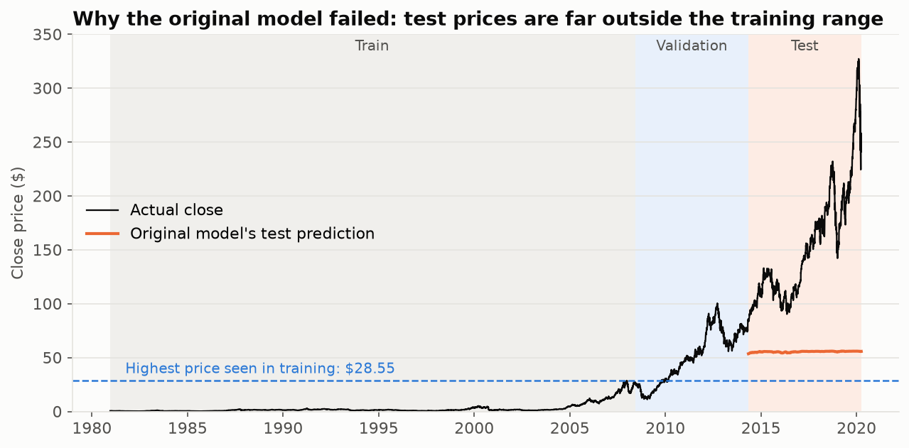
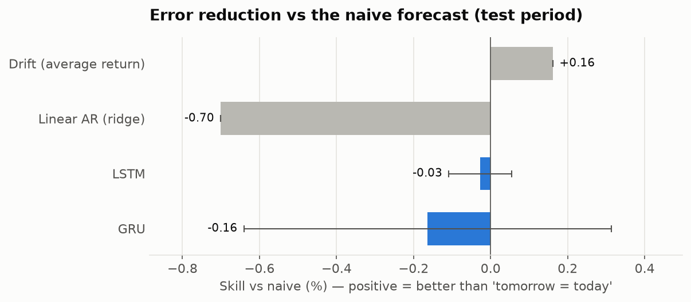
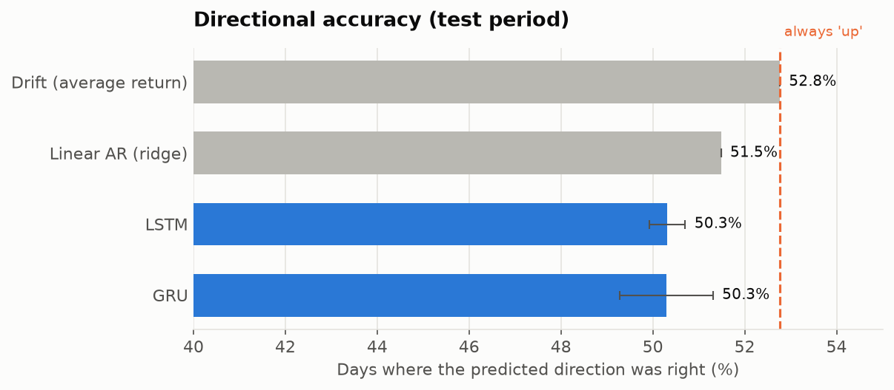
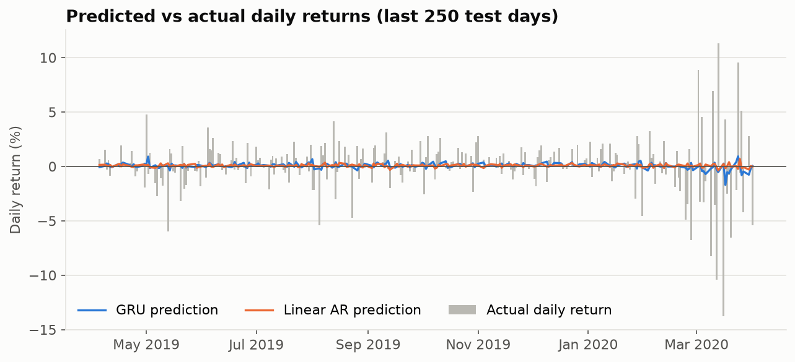

# Stock Forecasting with LSTM & GRU: an honest evaluation


Can an LSTM or GRU predict tomorrow's Apple (AAPL) stock price? This project answers that properly, by comparing them against the baselines most tutorials skip, over 40 years of daily data (1980–2020).

**Short answer: no.** Once the models are set up correctly, neither beats the naive forecast "tomorrow's price = today's price". The project shows why the first version looked broken, how to fix it, and how to evaluate a forecaster so it can't fool you.

> ⚠️ Educational project. Nothing here is financial advice or a trading signal.

## 1. Why the first version failed

The original notebook ([`notebooks/00_original_price_level_lstm_gru.ipynb`](notebooks/00_original_price_level_lstm_gru.ipynb)) trained an LSTM/GRU on **raw closing prices** scaled with `MinMaxScaler`. It scored a test **R² of −2.7**. This repo re-creates that model (`stock_forecast/original.py`), and it fails the same way: **R² −3.43**.



The scaler was fitted on the training period (1981–2008), when AAPL never closed above **$28.55**. The test period (2014–2020) runs from $84 to $327, so test inputs get scaled to values up to about 11 instead of 0–1. The network has never seen anything like that, and it predicts an almost flat line around $55.

## 2. The fix

| | Original | This repo |
|---|---|---|
| Target | Next-day **price** | Next-day **log return**, `log(Close_t / Close_{t-1})` |
| Inputs | 60 days of raw close | 60 days of return, high–low range, volume change |
| Scaling | MinMax on prices (non-stationary) | Standardised returns (roughly stationary across 40 years) |
| Baselines | None | Naive, drift, linear autoregressive (ridge) |
| Seeds | 1 | 3 per model (mean ± std reported) |

A predicted return converts back to a price as `Close_{t-1} × exp(predicted return)`, so every model is also scored on price.

Chronological split, no shuffling across periods: **train** 1981–2008 · **validation** 2008–2014 · **test** 2014–2020 (1,487 trading days, including the COVID crash). Feature scaling is fitted on the training period only, and a test checks that no input window contains data from its target day or later.

## 3. Results (test period, 2014-05-07 → 2020-04-01)

| Model | Skill vs naive (%) | Directional Acc (%) | Return RMSE (%) | Price RMSE ($) | Price MAPE (%) | Price R² |
|---|---|---|---|---|---|---|
| Naive (tomorrow = today) | 0.00 | — | 1.729 | 3.29 | 1.16 | 0.9962 |
| Drift (average return) | +0.16 | 52.76 | 1.728 | 3.29 | 1.16 | 0.9962 |
| Linear AR (ridge) | −0.70 | 51.48 | 1.736 | 3.30 | 1.17 | 0.9962 |
| LSTM | −0.03 ± 0.08 | 50.31 ± 0.39 | 1.730 | 3.27 | 1.17 | 0.9962 |
| GRU | −0.16 ± 0.48 | 50.29 ± 1.02 | 1.731 | 3.29 | 1.17 | 0.9962 |
| Original: GRU on raw prices | −347,341 | 47.24 | 101.9 | 112.12 | 60.25 | −3.43 |

*Skill vs naive* = % reduction in squared error compared with predicting no change. *Directional accuracy* only counts days where the price moved. On this period, always guessing "up" scores **52.8%**.

<p>
  
  
</p>

### What the numbers say

- **R² of 0.996 means nothing here.** The naive "no change" forecast already gets it, because today's price explains almost all of tomorrow's. Price R² and MAPE can't tell a useful model from a useless one; *skill vs naive* can.
- **No model beats the naive forecast in a meaningful way.** The LSTM and GRU sit within ±0.5% of it, with error bars that cross zero. Seed-to-seed variation (GRU std 0.48%) is larger than any difference between models.
- **Direction is no better than a coin flip with a bias.** Both recurrent models (about 50.3%) do *worse* than always predicting "up" (52.8%). A binomial test against the always-up rate gives p ≈ 0.95, so there's no evidence of skill.
- **The models learn to predict "almost nothing".** 98% of their predicted returns fall between about −0.5% and +0.7%, while real daily moves reach ±14% (March 2020). That is the best a squared-error model can do when tomorrow's return is close to unpredictable:



- **The validation period was misleading.** On validation (2008–2014) the LSTM and GRU scored about **+1.3%** skill vs naive. That edge disappeared on the test period. Choosing models on one historical window and trusting that number is how backtests overfit.

This matches the weak form of the efficient market hypothesis: past prices of a heavily traded stock carry very little information about the next day's return.

## Project structure

```
├── stock_forecast/
│   ├── data.py          # Features, chronological split, leak-free windows
│   ├── models.py        # Naive, drift, ridge AR, LSTM/GRU forecasters
│   ├── original.py      # Re-creation of the original price-level GRU
│   ├── metrics.py       # Skill vs naive, directional accuracy (+ binomial test), price metrics
│   ├── plots.py         # Report figures
│   └── train.py         # Runs everything -> models/, reports/
├── data/aapl_daily_1980_2020.csv
├── models/              # Best-seed LSTM/GRU (.keras), scaler + ridge (.joblib)
├── reports/             # model_comparison.md, metrics.json, train_log.txt, figures/
├── notebooks/           # Original course notebook (price-level LSTM/GRU)
└── tests/               # Leakage, split, scaling and metric tests
```

## Quickstart

```bash
git clone https://github.com/arslanahmedbhutto/stock-forecasting-lstm-gru.git
cd stock-forecasting-lstm-gru
python -m venv .venv
source .venv/bin/activate              # Windows: .venv\Scripts\activate
pip install -r requirements-dl.txt     # tests only: requirements.txt

python -m stock_forecast.train         # ~45 min on a 4-core CPU (3 seeds)
python -m stock_forecast.train --seeds 1
pytest
```

## Ideas for next steps

- Walk-forward (rolling-origin) evaluation across many test windows instead of one
- Predict volatility instead of direction: unlike returns, volatility *is* predictable (see the March 2020 cluster above)
- Add exogenous inputs (market index, sector ETFs, earnings dates)

## Data

AAPL daily OHLCV from Yahoo Finance (1980-12-12 to 2020-04-01, split-adjusted `Close`).

## Tech stack

Python · TensorFlow / Keras · scikit-learn · SciPy · pandas · matplotlib · pytest · GitHub Actions
